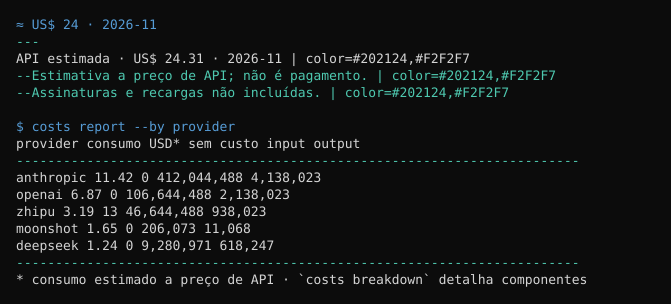

# costs

Cost and usage consolidator for AI coding agents. Collects the daily usage of each harness (Claude Code, Codex, OpenCode, Pi, ZCode, Kimi, Grok) with native collectors (reads each agent's own logs — no `ccusage`), stores it in SQLite, and shows spend, quota and balance in the terminal, the macOS menu bar (SwiftBar), a system tray app (`costs-tray`) or a Linux desktop widget (Noctalia). Single Rust binary per component.

The displayed value is **estimated consumption at API prices**, not what you paid: monthly subscriptions are shown separately and top-ups are not counted.




## Features

- **Native collectors** for Claude Code, Codex, OpenCode, Pi, ZCode, Kimi and Grok — reads each agent's local logs directly.
- **SQLite history** (`store.sqlite`): source logs can be pruned; the database keeps what was collected. Monotonic merge — a day only grows (see [Data and backup](#data-and-backup)).
- **Multi-host**: `ssh` hosts run `costs collect` remotely over a versioned JSON protocol; one ssh call per host per sync.
- **Real prices**: `costs prices` resolves every model in the database from the official LiteLLM table, falling back to the OpenRouter catalog for models without an official price.
- **Quota/balance windows** per provider with a shared priority heuristic ("use before it resets") — see below.
- **Menu bar / tray / desktop widget**: SwiftBar plugin (macOS), `costs-tray` crate (macOS/Windows/Linux DBus), Noctalia shell widget (Linux).
- **Repricing**: recompute stored history when the price catalog changes (dry-run by default).
- **Backups**: SQLite backup API, retention, optional atomic ship to a remote host over ssh.

## Requirements

- Rust toolchain only to build; the binaries run standalone
- `costs` in `~/.local/bin/costs` on each `ssh` host (same version as local; see [Remote hosts](#remote-hosts))
- Optional: `ai-usage` helper for quota windows, `grok` CLI on hosts running the Grok agent
- Key-based ssh for remote hosts (alias in `~/.ssh/config`)
- Optional: macOS + SwiftBar for the menu bar

## Build and install

```bash
cargo build --release
mkdir -p ~/.local/bin
cp target/release/costs ~/.local/bin/costs
# optional: tray app
cp target/release/costs-tray ~/.local/bin/costs-tray

costs doctor                              # checks remote costs, grok and prices.json
costs sync                                # collects all enabled hosts
costs report --by provider --month 2026-10
```

## Commands

| Command | What it does |
|---|---|
| `costs sync [--host H] [--agent A] [--replace]` | collect hosts (in parallel) and merge into history (`--replace` rewrites the resent days) |
| `costs report [--by host\|agent\|provider\|model\|provider+model\|date] [--month YYYY-MM]` | aggregated total |
| `costs breakdown [--month YYYY-MM]` | cost by component (input, output, cache) vs collected cost |
| `costs quota [--refresh \| --if-stale]` | quota windows and balance per provider; `--if-stale` only goes to the network past the cache TTL (timers, UIs), `--refresh` always (explicit buttons) |
| `costs menubar [--horizon 5h]` | SwiftBar-formatted output |
| `costs status [--month YYYY-MM]` | JSON summary for the Noctalia widget (read-only) |
| `costs prices` | download prices (official LiteLLM table, OpenRouter fallback) for every used model into `prices.json` |
| `costs repricing [--month YYYY-MM] [--all] [--apply]` | recompute stored rows (dry-run by default; never touches `allocated`) |
| `costs doctor [--host H]` | validate ssh hosts' `costs` (presence and version), `grok`, price freshness and unpriced rows |
| `costs runs [--limit N] [--errors] [--host H] [--agent A]` | collection history and failures |
| `costs history [--limit N] [--model M]` | recorded observations (including ones ignored for shrinking days) |
| `costs backup [--keep N] [--remote HOST]` | consistent SQLite copy + optional ssh ship |
| `costs collect --agent A [--agent B ...] [--host H] [--context -]` | collect this host's agents and print JSON (`sync` calls it remotely via ssh) |
| `costs migrate` | migrate the v1 database to v2 (with backup) |
| `costs install-service [--dry-run\|--apply]` | generate the OS scheduling for sync/backup |
| `costs uninstall-service [--apply]` | print (and with `--apply` remove) the scheduling |

Global options (`--config`, `--db`) come before the subcommand.

## Configuration

- `COSTS_HOME`: when set, `config.toml`, `models.toml`, `store.sqlite`, `prices.json` and `backups/` all live in that directory; otherwise platform defaults are used
- `config.toml` (see `config.example.toml`):
  - `agents`: default agents for every host
  - `[[hosts]]`: `name`, `kind` (`local`/`ssh`), `target` (ssh alias), `enabled`, `agents`, `path_prefix`. `source` is optional: `native` (local only, default) or `remote` (ssh only, default)
  - `[quota]`: `ai-usage` path, usage horizon and quota-provider → cost-provider map
  - `[[subscriptions]]`: fixed monthly spend (not counted as consumption)
- `models.toml` holds provider rules and `[[price_map]]` entries (explicit canonical-name → OpenRouter id overrides)
- `prices.json` is generated by `costs prices` and is not versioned

### Quota priority heuristic

The shared Noctalia/SwiftBar policy uses the total allowance: **monthly first**, then weekly, otherwise the farthest known reset. Auxiliary windows such as five-hour or MCP limits remain hard blockers when exhausted.

For usable providers, the deadline is the earlier of the allowance reset and the nearest known expiry of an available reset credit. Within the configured horizon, then beyond it, higher remaining percentage per hour to that deadline sorts first. More available credits break otherwise equal priorities; money balances come last. Entries whose quota query failed remain visible with last good values, but are excluded from recommendations until a query succeeds.

Expired credits are removed from the cached count. Missing expiry dates do not invent urgency. Credits are not multiplied into an assumed extra allowance: [their scope may be session or weekly](https://support.claude.com/en/articles/17007452-what-is-a-limit-reset), and the normalized cache does not carry that scope. Blocked providers stay outside "Use before" until redemption/reset is confirmed; no credit is redeemed automatically. The panel and menu explain the basis through `priority_hint` in `costs status`. This is a scheduling heuristic, not a conversion between providers' quota units.

z.ai reset credits come from an undocumented client flow (key handshake, proof-of-work, zcode client headers). It runs at most every 6 hours (stamp `zai.resets-at` in the quota cache); in between, the cached credits are kept. `COSTS_ZAI_RESETS=0` turns it off.

### OpenCode Go key rotation

Quota credentials are read without changing harness files. The priority is the selected `AI_USAGE_HARNESS` (`pi` or `opencode`), then `OPENCODE_GO_API_KEY`, then Pi and OpenCode `opencode-go` entries in their `auth.json` files. If a credential is rejected, OpenCode Go tries the next distinct configured credential. Network or parsing errors do not switch credentials, and a generic Zen key is never used as a Go key. A valid environment key keeps its existing priority.

This lets a running desktop pick up a key rotated in Pi/OpenCode without restarting. The usage request identifies itself as `costs/<version>`; Cloudflare error 1010 is reported as an HTTP problem, not as an invalid key.

### Pricing and coverage

`costs prices` resolves **every** model that appears in the database and writes `prices.json` indexed by canonical name. Two sources, one download each:

1. **LiteLLM table** (`model_prices_and_context_window.json`), only entries from the official vendor (Anthropic, OpenAI, Z.AI, xAI, Moonshot, DeepSeek, Google, Meta, Alibaba, MiniMax). List price, unaffected by routing.
2. **OpenRouter catalog**, only for models without an official price. OpenRouter's price for a model changes with the reference provider (GLM pricing has varied 9x within a day).

Order: explicit `[[price_map]]` (looked up in the official table first) → exact slug → variants (`antigravity-`, `-high`, `-fast`, `-preview`, `-build`, `-256k`, `.`↔`-`) in LiteLLM, then OpenRouter → nearest sibling of the same provider (OpenRouter only). Siblings are marked `sibling` and their cost `cost_basis = "fallback"`. `resolved.<model>.source` tells which table each price came from. One source being down does not block the other.

`costs sync` re-downloads prices when `prices.json` is older than a day (failure only warns and keeps the current file). Only new rows use the new price: history changes only via `costs repricing`.

Free routes (`-free` / `:free`) cost **zero** and never get a catalog price. `-1` prices (router `auto`) are ignored. A model without catalog or sibling stays unpriced and is listed by `costs prices`, `costs breakdown` and `costs doctor` warnings.

After the first `costs prices` (or a catalog change), backfill history with:

```bash
costs repricing                # simulation: how many rows and how much US$
costs repricing --apply        # write (backs up SQLite first)
```

## Automation

```bash
costs install-service --apply
```

Writes the scheduling definitions (hourly sync; daily 03:30 backup) and prints the `launchctl` (macOS), `systemctl` (Linux) or `schtasks` (Windows) commands for you to run; `costs` never runs them itself.

On macOS there are also versioned scripts under `menubar/`, which resolve the binary from `$COSTS_BIN`, `~/.local/bin/costs` or `target/release/costs`, in that order:

- `menubar/com.github.lgldsilva.costs.sync.plist`: hourly collection (LaunchAgent)
- `menubar/com.github.lgldsilva.costs.backup.plist`: daily backup (03:30), 30-copy retention, atomic ship to `$COSTS_BACKUP_REMOTE` when reachable
- `menubar/costs.5m.sh`: SwiftBar plugin (every 5 minutes); refreshes quota before rendering the cached menu, preserving last good data when a provider fails

```bash
cp menubar/com.github.lgldsilva.costs.*.plist ~/Library/LaunchAgents/
launchctl bootstrap gui/$(id -u) ~/Library/LaunchAgents/com.github.lgldsilva.costs.sync.plist
launchctl bootstrap gui/$(id -u) ~/Library/LaunchAgents/com.github.lgldsilva.costs.backup.plist
ln -sf ~/src/costs/menubar/costs.5m.sh \
  "$HOME/Library/Application Support/SwiftBar/Plugins/costs.5m.sh"
```

Logs: `~/Library/Logs/costs-sync.log` and `~/Library/Logs/costs-backup.log`. The scripts use a per-directory lock in `${COSTS_HOME:-~/.local/share/costs}/locks` to prevent overlapping runs.

## Tray app

`costs-tray` (crate `crates/costs-tray`) shows the month's spend and quota in the system tray, reading the same database; collection stays with the scheduling above. Linux uses DBus/KStatusNotifierItem; macOS and Windows use native tray APIs.

## Noctalia widget (Linux)

`noctalia/costs` is the shell bar plugin (`lgldsilva/costs:bar`): `≈ US$ X · age` text, provider/balance tooltip, click opens the panel, right-click opens the report. The widget and panel refresh session quotas before reading `costs status` (the snapshot command itself stays read-only and offline). See `noctalia/costs/README.md`:

```bash
mkdir -p ~/.local/share/noctalia/plugins
ln -s ~/src/costs/noctalia/costs ~/.local/share/noctalia/plugins/costs
noctalia msg plugins enable lgldsilva/costs
```

```toml
[widget.costs]
type = "lgldsilva/costs:bar"

[bar.default]
end = ["costs", "tray", ...]
```

## Remote hosts

`kind = "ssh"` hosts run their own `costs` in `~/.local/bin/costs`. `sync` makes a single ssh call per host:

```bash
ssh -o BatchMode=yes -o ConnectTimeout=10 -o ServerAliveInterval=5 -o ServerAliveCountMax=3 \
  -- <target> \
  '<path_prefix>
"$HOME/.local/bin/costs" collect --host <name> --agent claude --agent pi ... --context -'
```

The `path_prefix` goes on its own line (may end with `;` or a comment).

- stdin: JSON context `{"version":2,"models":"<models.toml>","prices":<prices.json>|null}`, assembled on the local host; the remote needs no `config.toml`, `models.toml` or `prices.json`
- stdout: `{"version":2,"agents":{"claude":{"rows":[...]},"kimi":{"error":"..."}}}`; one agent's error (including a collector panic) does not take down the others
- received rows are rewritten with the locally configured host name and the provider is recomputed with the local `models.toml`
- different protocol version: all the host's agents fail asking to update `costs`; ssh exit 255: unreachable host (skips the rest); exit 127: `costs` missing; `costs` without the `collect` subcommand: asks to update
- one collection per host: if another is still running (e.g. the previous one stuck on I/O after the ssh timeout), `collect` exits with code 3 and the host shows as an error in `costs runs --errors`; the lock is `collect.lock`, next to that host's `store.sqlite`
- opencode: reads only the last 60 days (whole local days) via the indexed `time_created`, because the store already keeps the rest. To bring the full history from a new host, run a sync with `export COSTS_OPENCODE_LOOKBACK_DAYS=0` in its `path_prefix` and remove it afterwards

Installing on the remote host (same version as local):

```bash
# option 1: build on the host
git clone https://github.com/lgldsilva/costs ~/src/costs && cd ~/src/costs
cargo build --release -p costs && install -m 755 target/release/costs ~/.local/bin/costs

# option 2: copy an already-built binary to the same OS/architecture
scp target/release/costs <host>:.local/bin/costs

costs doctor --host <host>   # ok <host> costs <version>; WARN if the version differs
```

To test by hand on the host: `costs collect --agent claude` (without `--context` it uses its local `models.toml`/`prices.json`).

## Data and backup

`store.sqlite` is the historical memory: source logs can be pruned, but the database keeps what was collected. `sync` does a **monotonic merge**: a day only grows. If the source reports fewer tokens (archived/deleted session, incomplete day), the stored value is kept and the attempt goes to `usage_history` with verdict `ignored`; to apply an intentional correction use `costs sync --replace` (the old value also stays in history). `costs history` shows that log. None of it goes to git. Backups use the SQLite backup API (safe with the database open), keep the N most recent copies and ship one to a remote host over ssh (`.part` + `mv`, same retention on the destination).

## Security notes

`costs` reads agent logs and usage data locally and never sends them anywhere except to the ssh hosts you configure. Quota queries go directly to each provider with credentials read from the harness configs (`auth.json`) or the environment — no credentials are stored by `costs`, and none belong in `config.toml`. The z.ai reset flow uses an undocumented client endpoint; disable it with `COSTS_ZAI_RESETS=0`.

## Development

```bash
cargo fmt --all --check
cargo clippy --workspace --all-targets -- -D warnings
cargo test --workspace
node tests/report-dashboard.cjs          # offline dashboard regressions
lua5.4 noctalia/costs/tests/sync_test.lua
bash menubar/tests/refresh_test.sh
```

Layout: `crates/costs-core` (collection, store, reports, quota, backup), `crates/costs` (CLI), `crates/costs-tray` (tray), `menubar/` (SwiftBar + launchd), `noctalia/costs` (Linux desktop widget), `macos/CostsPreview` (native macOS menu bar app).

## License

[MIT](LICENSE)
